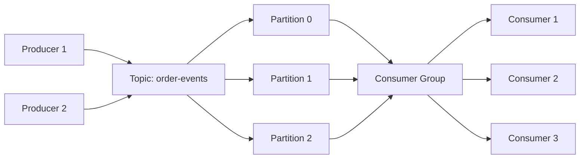

# Part 1: Introduction to Apache Kafka — Complete Deep Dive

> Apache Kafka ek distributed, fault-tolerant, high-throughput event-streaming platform hai. Ye microservices ke beech asynchronous communication, real-time data pipelines, event sourcing, CDC, log aggregation aur analytics ke liye use hota hai.

---

## 1. Kafka Kya Hai?

Apache Kafka ek **distributed event streaming platform** hai.

Simple words me:

```text
Kafka = High-speed, durable, scalable event highway
```

Applications Kafka me events publish karti hain, aur doosri applications un events ko subscribe karke process karti hain. Kafka events ko topics me organize aur durably store karta hai. [471]

### Real-Life Analogy

Socho ek railway station:

```text
Train = Event
Platform = Kafka Topic
Train Coach = Kafka Partition
Passenger = Consumer
Railway Control Room = Kafka Broker
```

Ek event publish hota hai, Kafka usko topic me store karta hai, aur interested consumers usko apne pace par read karte hain.

---

## 2. Kafka Ko Samajhne Ka Sahi Tarika

Kafka ko sirf “message queue” samajhna incomplete hai.

Kafka actually teen cheezein ek saath provide karta hai:

| Capability | Meaning |
|---|---|
| Messaging System | Services ke beech asynchronous messages bhejna |
| Storage System | Events ko durable, replayable form me store karna |
| Stream Processing System | Events ko real-time process, transform aur analyze karna |

Kafka ko distributed, partitioned aur replicated commit log ke roop me describe kiya jata hai. [472]

---

## 3. Event Kya Hota Hai?

Event koi bhi “kuch hua” ka digital record hai.

### Examples

```text
User registered
Order created
Payment completed
Post liked
Product viewed
Inventory updated
Cache invalidated
User logged in
```

### Event Structure

```json
{
  "eventId": "evt_10293",
  "eventType": "ORDER_CREATED",
  "occurredAt": "2026-10-19T14:30:00Z",
  "aggregateId": "order_8721",
  "payload": {
    "orderId": "order_8721",
    "userId": "user_101",
    "totalAmount": 2499.00,
    "currency": "INR"
  },
  "metadata": {
    "source": "order-service",
    "version": "1.0"
  }
}
```

### Event vs Message

| Term | Meaning |
|---|---|
| Message | Generic data unit sent between systems |
| Event | Business-meaningful fact: “something happened” |
| Command | Request to do something |
| Query | Request to read data |

Example:

```text
Command: CreateOrder
Event: OrderCreated
Query: GetOrderById
```

---

## 4. Kafka Kyun Use Karte Hain?

### Problem Without Kafka

```text
Order Service
   |
   +--> Email Service
   +--> Inventory Service
   +--> Notification Service
   +--> Analytics Service
```

Issue:

```text
- Tight coupling
- Synchronous failures
- Slow API response
- One service down affects order flow
- Hard to add new consumers
- Difficult replay/recovery
```

### Solution With Kafka

```text
Order Service
      |
      | publishes OrderCreated
      v
   Kafka Topic
      |
      +--> Email Service
      +--> Inventory Service
      +--> Notification Service
      +--> Analytics Service
```

Benefit:

```text
- Loose coupling
- Independent scaling
- Failure isolation
- Replay support
- Easy new consumer onboarding
- High throughput
```

Kafka topics multi-producer and multi-subscriber hote hain — ek topic par multiple producers likh sakte hain aur multiple consumers independently read kar sakte hain. [471]

---

## 5. Kafka Core Concepts

### 5.1 Producer

Producer wo application hai jo Kafka me events publish karti hai.

```text
Order Service --> Kafka
```

Example events:

```text
OrderCreated
PaymentCompleted
UserRegistered
PostLiked
```

### 5.2 Consumer

Consumer wo application hai jo Kafka se events read karti hai.

```text
Kafka --> Notification Service
Kafka --> Analytics Service
Kafka --> Email Service
```

### 5.3 Topic

Topic events ka logical category hai.

```text
order-events
payment-events
user-events
notification-events
```

Example:

```text
Topic: order-events

OrderCreated
OrderCancelled
OrderShipped
OrderDelivered
```

### 5.4 Partition

Har topic multiple partitions me divide hota hai.

```text
Topic: order-events

Partition 0: [Event 1, Event 4, Event 7]
Partition 1: [Event 2, Event 5, Event 8]
Partition 2: [Event 3, Event 6, Event 9]
```

Partition parallelism, scalability aur ordering control deta hai. Ek partition ke andar events ordered hote hain, lekin partitions ke beech global ordering guarantee nahi hoti. [477]

### 5.5 Offset

Offset ek partition ke andar message ki position hai.

```text
Partition 0:
Offset 0 -> OrderCreated
Offset 1 -> OrderCancelled
Offset 2 -> OrderShipped
```

Consumer offset track karta hai taaki restart ke baad wahi se processing resume kar sake. [458]

### 5.6 Consumer Group

Consumer group ek team hoti hai jo ek topic ko process karti hai.

```text
Topic: order-events
Partitions: 3

Consumer Group: notification-service-group

Consumer 1 -> Partition 0
Consumer 2 -> Partition 1
Consumer 3 -> Partition 2
```

Ek consumer group me ek partition ek time par sirf ek consumer process karta hai. [446][463]

### 5.7 Broker

Broker Kafka server hota hai jo events store karta hai aur producer/consumer requests handle karta hai.

```text
Kafka Cluster
   |
   +--> Broker 1
   +--> Broker 2
   +--> Broker 3
```

### 5.8 Replica

Replica partition ki copy hoti hai.

```text
Partition 0
   |
   +--> Leader Replica: Broker 1
   +--> Follower Replica: Broker 2
   +--> Follower Replica: Broker 3
```

Replication fault tolerance deta hai.

### 5.9 Cluster

Multiple brokers milke Kafka Cluster banate hain.

```text
Kafka Cluster
   |
   +--> Broker 1
   +--> Broker 2
   +--> Broker 3
   +--> Broker 4
```

---

## 6. Kafka Architecture



### Detailed Flow

```text
1. Producer event generate karta hai
2. Producer Kafka broker ko event bhejta hai
3. Kafka event ko topic ke partition me append karta hai
4. Kafka event ko replicas me copy karta hai
5. Consumer group event ko read karta hai
6. Consumer processing complete hone par offset commit karta hai
7. Consumer restart hone par committed offset se resume karta hai
```

---

## 7. Kafka Topic and Partition Example

### Topic Creation

```bash
kafka-topics.sh \
  --bootstrap-server localhost:9092 \
  --create \
  --topic order-events \
  --partitions 3 \
  --replication-factor 3
```

### Describe Topic

```bash
kafka-topics.sh \
  --bootstrap-server localhost:9092 \
  --describe \
  --topic order-events
```

### Produce Event

```bash
kafka-console-producer.sh \
  --bootstrap-server localhost:9092 \
  --topic order-events
```

### Consume Events

```bash
kafka-console-consumer.sh \
  --bootstrap-server localhost:9092 \
  --topic order-events \
  --from-beginning
```

---

## 8. Kafka Event Flow Example

### Scenario: Order Created

```text
1. User places an order
2. Order Service validates request
3. Order Service saves order in PostgreSQL
4. Order Service publishes ORDER_CREATED event
5. Kafka stores event in order-events topic
6. Inventory Service consumes event and reduces stock
7. Email Service consumes event and sends confirmation
8. Analytics Service consumes event and updates dashboard
```

### Event

```json
{
  "eventId": "evt_9921",
  "eventType": "ORDER_CREATED",
  "orderId": "order_8721",
  "userId": "user_101",
  "items": [
    {
      "productId": "prod_55",
      "quantity": 2
    }
  ],
  "totalAmount": 2499.00,
  "occurredAt": "2026-10-19T14:30:00Z"
}
```

---

## 9. Kafka Use Cases

| Use Case | Example |
|---|---|
| Microservice communication | Order Service publishes `OrderCreated`; Notification Service consumes it |
| Real-time analytics | Clickstream events processed for dashboards |
| Log aggregation | Application logs collected centrally |
| Event sourcing | Store state changes as immutable events |
| Change Data Capture | Database changes streamed to downstream systems |
| Fraud detection | Payment events analyzed in real time |
| Recommendation systems | User activity events processed |
| Cache invalidation | DB update event invalidates Redis cache |
| Audit logging | Security and compliance events stored |
| IoT data processing | Sensor events streamed and processed |

Kafka commonly real-time analytics, event sourcing, CDC, log aggregation aur microservices ke asynchronous communication me use hota hai. [476]

---

## 10. Kafka vs Traditional Message Queue

| Feature | Traditional Queue | Kafka |
|---|---|---|
| Message storage | Usually delete after consume | Retain for configured period |
| Replay | Usually difficult | Easy with offsets |
| Multiple consumer groups | Limited or complex | Native support |
| Throughput | Lower | Very high |
| Ordering | Queue-dependent | Per-partition ordering |
| Scalability | Limited | Partition-based horizontal scaling |
| Stream processing | Usually separate system | Kafka Streams available |
| Use case | Task queue | Event streaming backbone |

---

## 11. Kafka vs RabbitMQ

| Feature | Kafka | RabbitMQ |
|---|---|---|
| Primary model | Distributed commit log | Message broker |
| Message retention | Configurable retention | Usually removed after ack |
| Replay support | Strong | Limited |
| Ordering | Per partition | Queue-dependent |
| Throughput | Very high | Moderate to high |
| Best for | Event streaming, analytics, CDC | Task queues, routing, complex routing |
| Consumer model | Consumer groups and offsets | Consumers and queues |
| Stream processing | Kafka Streams | External processors |

---

## 12. Kafka vs Redis Streams

| Feature | Kafka | Redis Streams |
|---|---|---|
| Primary strength | Large-scale event streaming | Lightweight in-memory streaming |
| Storage | Disk-based durable log | Memory-first with persistence |
| Scalability | Very high | Moderate |
| Consumer groups | Mature and powerful | Supported |
| Retention | Configurable, long-term | Memory-dependent |
| Ecosystem | Very large | Smaller |
| Best for | Enterprise event backbone | Simple real-time event flow |

Rule of thumb:

```text
Simple in-memory event flow -> Redis Streams
Large-scale durable event backbone -> Kafka
```

---

## 13. Kafka Delivery Semantics

| Semantics | Meaning | Risk |
|---|---|---|
| At-most-once | Message at most one time process hota hai | Data loss possible |
| At-least-once | Message at least one time process hota hai | Duplicate processing possible |
| Exactly-once | Message exactly one time process hota hai | Complex setup and overhead |

### At-Least-Once Example

```text
Consumer processes event
Consumer crashes before offset commit
Restart hone par event dobara process hoga
```

Solution:

```text
Idempotent consumer banao
```

Example:

```text
ORDER_CREATED event processed twice
-> Check eventId already processed?
-> If yes, skip
-> If no, process and store eventId
```

---

## 14. Kafka Ordering Rules

Important rule:

```text
Ordering is guaranteed within a partition,
not across partitions.
```

### Correct Design

Same `orderId` wale events ko same partition me bhejo.

```text
Key = orderId
Partition = hash(orderId) % number_of_partitions
```

```text
orderId = order_8721

ORDER_CREATED   -> Partition 1
PAYMENT_COMPLETED -> Partition 1
ORDER_SHIPPED   -> Partition 1
```

Isse event order preserve hota hai.

---

## 15. Kafka Key Concepts Summary

| Concept | Meaning |
|---|---|
| Event | Business fact: “something happened” |
| Producer | Event publish karne wali application |
| Consumer | Event read/process karne wali application |
| Topic | Events ka logical category |
| Partition | Topic ka physical, ordered log segment |
| Offset | Partition me message ki position |
| Consumer Group | Topic ko collectively process karne wale consumers |
| Broker | Kafka server |
| Cluster | Multiple Kafka brokers |
| Replica | Partition ki copy |
| Leader | Primary replica handling reads/writes |
| Follower | Leader ka backup replica |

---

## 16. When Not to Use Kafka

Kafka har problem ka solution nahi hai.

Avoid Kafka when:

```text
- Simple request-response communication chahiye
- Very low message volume hai
- Complex routing chahiye
- Short-lived task queue chahiye
- Team Kafka operations handle nahi kar sakti
- Real-time query database chahiye
- Single small monolith hai
```

### Better Alternatives

| Requirement | Better Option |
|---|---|
| Simple HTTP communication | REST / gRPC |
| Task queue | RabbitMQ / SQS |
| Simple in-memory events | Redis Streams |
| Complex routing | RabbitMQ |
| Real-time database queries | PostgreSQL / MySQL |
| Background jobs | Spring Batch / Quartz / Celery-style workers |

---

## 17. Kafka in a Spring Boot System

```text
Spring Boot API
      |
      +--> PostgreSQL
      |
      +--> Redis Cache
      |
      +--> Kafka
              |
              +--> Notification Service
              +--> Analytics Service
              +--> Email Service
              +--> Cache Invalidation Service
```

### Example Flow

```text
POST /orders
   |
   v
Order Service
   |
   +--> Save order in PostgreSQL
   |
   +--> Publish ORDER_CREATED to Kafka
   |
   +--> Return response
```

Consumer services independently process the event:

```text
ORDER_CREATED
   |
   +--> Inventory Service: reduce stock
   +--> Email Service: send confirmation
   +--> Analytics Service: update metrics
   +--> Cache Service: invalidate relevant cache
```

---

## 18. Common Beginner Mistakes

### Mistake 1 — Kafka Ko Synchronous RPC Samajhna

```text
Wrong:
Client -> API -> Kafka -> Immediate response expected

Correct:
Client -> API -> Publish event -> Return 202 Accepted
```

### Mistake 2 — Har Cheez Kafka Me Bhejna

```text
Wrong:
User profile read request -> Kafka

Correct:
User profile read -> Redis/Database
User profile updated -> Kafka event
```

### Mistake 3 — Partition Ordering Ignore Karna

```text
Wrong:
Random partition for order events

Correct:
Use orderId as key so related events stay ordered
```

### Mistake 4 — Idempotency Ignore Karna

```text
Wrong:
Assume event only once aayega

Correct:
Design consumer for duplicate events
```

### Mistake 5 — Auto Topic Creation Enable Rakhna

```text
Wrong:
Kafka automatically creates random topics

Correct:
Create topics intentionally with partitions,
replication factor and retention policy
```

---

## 19. Production Mindset

Production Kafka design me ye sawal pehle poochne chahiye:

```text
1. Ye event business-critical hai?
2. Event lose ho sakta hai?
3. Duplicate processing acceptable hai?
4. Event ordering chahiye?
5. Event replay chahiye?
6. Kitna throughput expected hai?
7. Kitne consumers honge?
8. Consumer lag acceptable limit kya hai?
9. Schema evolution kaise handle hoga?
10. Failure hone par kya hoga?
```

---

## 20. Interview Questions

### Basic

| Question | Answer |
|---|---|
| Apache Kafka kya hai? | Ek distributed event-streaming platform jo high-throughput, durable aur scalable event pipelines provide karta hai. |
| Kafka topic kya hai? | Events ka logical category/channel. |
| Kafka partition kya hai? | Topic ka physical, append-only ordered log segment. |
| Kafka offset kya hai? | Partition me message ki position/sequence number. |
| Producer kya hai? | Kafka me event publish karne wali application. |
| Consumer kya hai? | Kafka se event read karne wali application. |

### Intermediate

| Question | Answer |
|---|---|
| Consumer group kya hai? | Ek team of consumers jo topic partitions ko share karke process karti hai. |
| Kafka ordering kaise kaam karta hai? | Ordering per partition guaranteed hai, across partitions nahi. |
| Kafka replay kaise karta hai? | Consumer committed offset reset karke purane events dobara read kar sakta hai. |
| At-least-once kya hai? | Message at least once process hota hai; duplicates possible hain. |
| Exactly-once kya hai? | Message exactly once process hota hai; idempotence aur transactions se achieve hota hai. |
| Kafka durable kyun hai? | Events disk par replicated log ke roop me store hote hain. |

### Scenario-Based

| Scenario | Answer |
|---|---|
| Order events ka order preserve karna hai | `orderId` ko Kafka key banao |
| Payment event duplicate process ho raha hai | Idempotent consumer aur processed-event tracking lagao |
| Consumer slow hai | Consumer lag, downstream latency, concurrency aur partition count check karo |
| New analytics service add karna hai | Naya consumer group banao; producer code change nahi karna padega |
| Kafka down ho jaye | Producer retry/outbox use karo; consumer graceful degradation rakho |

---

## 21. Key Takeaways

```text
1. Kafka ek event-streaming platform hai,
   sirf message queue nahi.

2. Kafka events ko topics me durably store karta hai.

3. Topics partitions me divide hote hain.

4. Partitions parallelism aur scalability dete hain.

5. Ordering per partition guaranteed hoti hai.

6. Consumer groups independent processing enable karte hain.

7. Kafka replay, decoupling aur fault tolerance deta hai.

8. Kafka microservices, analytics, CDC aur event sourcing ke liye ideal hai.

9. Kafka har problem ka solution nahi hai.

10. Production me reliability, ordering,
    idempotency aur monitoring pehle se design karo.
```

---

## 22. Next Part Preview

**Part 2: Kafka Architecture — Broker, Topic, Partition, Replica, Leader, ISR and KRaft**

Isme hum deeply cover karenge:

```text
- Kafka broker internals
- Topic and partition storage
- Replication and ISR
- Leader election
- KRaft mode vs ZooKeeper
- Kafka metadata
- Partition assignment
- Broker failure handling
```