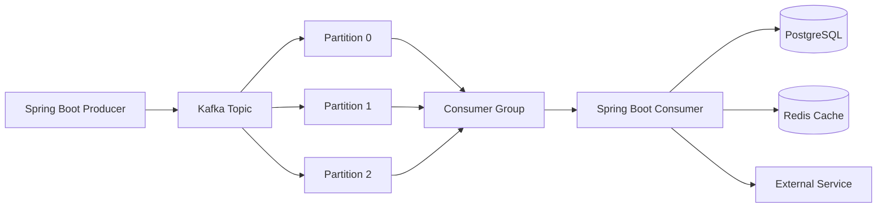

# Kafka + Spring Boot — Production-Oriented Complete Guide


> A complete, production-oriented guide for building **event-driven applications with Apache Kafka and Spring Boot** — covering Kafka fundamentals, producers, consumers, consumer groups, reliability, retries, dead letter topics, Kafka Streams, event-driven microservices, security, monitoring, Docker, Kubernetes, testing, and real-world projects.

---

## 📌 About This Repository

This repository is a structured learning path and production reference for using **Apache Kafka with Spring Boot**.

It is designed for Java backend developers, microservice developers, and students who want to understand Kafka not only as a message broker, but as a durable, scalable event-streaming platform for modern distributed systems.

### What Makes This Guide Different?

- Production-oriented, not only beginner tutorials
- Complete Spring Boot code examples
- Kafka CLI + Java implementation side by side
- Real-world event-driven use cases
- Producer and consumer reliability patterns
- Retry, dead letter topics, idempotency, and transactions
- Kafka Streams and stream processing
- Security, monitoring, Docker, Kubernetes, and testing
- Interview preparation with scenario-based questions
- Final event-driven microservices project using Kafka, Redis, and Spring Boot

---

## 🚀 Quick Start

### Prerequisites

- Java 17+
- Maven 3.8+
- Docker and Docker Compose
- Basic Spring Boot knowledge

### 1. Clone the Repository

```bash
git clone [https://github.com/your-username/kafka-spring-boot-guide.git](https://github.com/your-username/kafka-spring-boot-guide.git)
cd kafka-spring-boot-guide
```

### 2. Start Kafka Using Docker

```bash
docker compose up -d
```

### 3. Run Spring Boot Application

```bash
./mvnw spring-boot:run
```

### 4. Check Kafka Topics

```bash
docker exec -it kafka kafka-topics.sh \
  --bootstrap-server localhost:9092 \
  --list
```

### 5. Check Application Health

```bash
curl http://localhost:8080/actuator/health
```

---

## 🏗️ Architecture



### High-Level Flow

```text
Producer Service
      |
      | Publish Event
      v
Kafka Topic
      |
      +--> Partition 0
      +--> Partition 1
      +--> Partition 2
      |
      v
Consumer Group
      |
      +--> Consumer Instance 1
      +--> Consumer Instance 2
      +--> Consumer Instance 3
      |
      v
Database / Redis / External System
```

Kafka organizes events into topics, topics into partitions, and distributes partitions across consumers in a consumer group. A consumer tracks and commits offsets so it can resume processing after a restart. [443][458]

---

## 🧰 Tech Stack

| Layer | Technology |
|---|---|
| Language | Java 17+ |
| Framework | Spring Boot 3.x |
| Event Streaming | Apache Kafka |
| Spring Integration | Spring Kafka |
| Database | PostgreSQL / MySQL |
| Cache | Redis |
| Serialization | JSON / Avro / Protobuf |
| Schema Management | Confluent Schema Registry |
| Monitoring | Micrometer, Prometheus, Grafana |
| Containerization | Docker, Docker Compose |
| Orchestration | Kubernetes |
| Testing | JUnit 5, Mockito, Testcontainers, Embedded Kafka |

---

## ✨ What You Will Learn

### Kafka Fundamentals

- What is Apache Kafka?
- Kafka architecture
- Brokers, topics, partitions, replicas
- Producers and consumers
- Consumer groups
- Offsets and offset commits
- Rebalancing
- Kafka CLI
- Kafka vs Redis Streams vs RabbitMQ

### Spring Kafka Integration

- Spring Kafka setup
- `KafkaTemplate`
- `@KafkaListener`
- JSON serialization and deserialization
- Kafka configuration with `application.yml`
- Multiple topics and multiple listeners
- Manual offset acknowledgment

### Reliability

- Producer acknowledgements
- Producer retries
- Idempotent producers
- Consumer offset commit strategies
- At-most-once, at-least-once, and exactly-once semantics
- Error handling
- Retry topics
- Dead letter topics
- Kafka transactions

### Event-Driven Architecture

- Event-driven microservices
- Event sourcing
- CQRS
- Outbox pattern
- Saga pattern
- Domain events
- Event versioning
- Cache invalidation with Kafka
- Kafka + Redis integration

### Production Operations

- Kafka security
- SASL, SSL, and ACLs
- Monitoring and observability
- Consumer lag monitoring
- Docker deployment
- Kubernetes deployment
- Testing with Testcontainers
- Embedded Kafka testing
- Capacity planning
- Production runbook

---

## 📚 Documentation Index

| Part | Topic | Status |
|---|---|---|
| 01 | Introduction to Apache Kafka | ✅ |
| 02 | Kafka Architecture: Broker, Topic, Partition, Replica | ✅ |
| 03 | Producers, Consumers and Consumer Groups | ✅ |
| 04 | Offsets, Commit Strategies and Rebalancing | ✅ |
| 05 | Kafka CLI: Topics, Producers and Consumers | ✅ |
| 06 | Kafka vs Redis Streams vs RabbitMQ | ✅ |
| 07 | Spring Kafka Setup | ✅ |
| 08 | KafkaTemplate Deep Dive | ✅ |
| 09 | `@KafkaListener` Deep Dive | ✅ |
| 10 | JSON Serialization and Deserialization | ✅ |
| 11 | Kafka Configuration with `application.yml` | ✅ |
| 12 | Multiple Topics and Multiple Listeners | ✅ |
| 13 | Producer Reliability: `acks`, Retries, Idempotence | ✅ |
| 14 | Consumer Reliability and Manual Offset Commit | ✅ |
| 15 | Error Handling and Dead Letter Topics | ✅ |
| 16 | Retry with `@RetryableTopic` | ✅ |
| 17 | Exactly-Once Semantics and Idempotent Consumers | ✅ |
| 18 | Kafka Transactions | ✅ |
| 19 | Event-Driven Microservices | ✅ |
| 20 | Event Sourcing | ✅ |
| 21 | CQRS | ✅ |
| 22 | Outbox Pattern | ✅ |
| 23 | Saga Pattern | ✅ |
| 24 | Cache Invalidation with Kafka | ✅ |
| 25 | Kafka + Redis Integration Project | ✅ |
| 26 | Kafka Security: SASL, SSL, ACL | ✅ |
| 27 | Kafka Monitoring and Observability | ✅ |
| 28 | Docker and Kubernetes Deployment | ✅ |
| 29 | Kafka Testing: Testcontainers and Embedded Kafka | ✅ |
| 30 | Production Checklist, Runbook and Final Project | ✅ |

---

## 📁 Repository Structure

```text
kafka-spring-boot-guide/
├── README.md
├── LICENSE
├── pom.xml
├── docker/
│   └── docker-compose.yml
├── docs/
│   ├── 01-introduction-to-apache-kafka.md
│   ├── 02-kafka-architecture.md
│   ├── 03-producers-consumers-consumer-groups.md
│   ├── 04-offsets-commit-strategies-rebalancing.md
│   ├── 05-kafka-cli.md
│   ├── 06-kafka-vs-redis-streams-vs-rabbitmq.md
│   ├── 07-spring-kafka-setup.md
│   ├── 08-kafka-template-deep-dive.md
│   ├── 09-kafka-listener-deep-dive.md
│   ├── 10-json-serialization-deserialization.md
│   ├── 11-kafka-configuration-application-yml.md
│   ├── 12-multiple-topics-and-listeners.md
│   ├── 13-producer-reliability.md
│   ├── 14-consumer-reliability-manual-offset-commit.md
│   ├── 15-error-handling-dead-letter-topics.md
│   ├── 16-retryable-topic.md
│   ├── 17-exactly-once-semantics-idempotent-consumers.md
│   ├── 18-kafka-transactions.md
│   ├── 19-event-driven-microservices.md
│   ├── 20-event-sourcing.md
│   ├── 21-cqrs.md
│   ├── 22-outbox-pattern.md
│   ├── 23-saga-pattern.md
│   ├── 24-cache-invalidation-with-kafka.md
│   ├── 25-kafka-redis-integration-project.md
│   ├── 26-kafka-security-sasl-ssl-acl.md
│   ├── 27-kafka-monitoring-observability.md
│   ├── 28-docker-kubernetes-deployment.md
│   ├── 29-kafka-testing-testcontainers-embedded-kafka.md
│   └── 30-production-checklist-runbook-final-project.md
├── src/
│   └── main/
│       ├── java/
│       │   └── com/example/kafka/
│       │       ├── config/
│       │       ├── controller/
│       │       ├── producer/
│       │       ├── consumer/
│       │       ├── dto/
│       │       ├── event/
│       │       ├── service/
│       │       ├── exception/
│       │       └── streams/
│       └── resources/
│           ├── application.yml
│           └── application-local.yml
└── src/
    └── test/
        └── java/
            └── com/example/kafka/
                ├── unit/
                └── integration/
```

---

## 🔑 Kafka Topic Naming Convention

This guide follows a predictable and production-safe topic naming convention:

```text
<domain>.<entity>.<event-type>.v<version>
```

### Examples

```text
user.user.created.v1
user.user.updated.v1
order.order.created.v1
payment.payment.completed.v1
notification.notification.sent.v1
cache.user.profile.invalidated.v1
```

### Benefits

- Clear domain ownership
- Easy event discovery
- Safer schema evolution
- Better monitoring and alerting
- Supports versioned event contracts

---

## 🧠 Kafka Usage Patterns

| Use Case | Kafka Pattern |
|---|---|
| User registration event | Domain event |
| Order created event | Domain event |
| Payment success event | Domain event |
| Email/SMS notification | Consumer-based processing |
| Cache invalidation | Kafka + Redis consumer |
| Audit logging | Event sourcing |
| Analytics pipeline | Kafka Streams |
| Fraud detection | Kafka Streams |
| Microservice communication | Async event-driven communication |
| Distributed transaction | Saga pattern |
| Reliable DB + Kafka write | Outbox pattern |

---

## 🛡️ Production Best Practices

### Producer

- Use `acks=all` for critical business events.
- Enable idempotent producer for duplicate protection.
- Configure retries with bounded retry limits.
- Use meaningful event keys for partition ordering.
- Avoid sending huge payloads through Kafka.
- Use schema validation before publishing events.

### Consumer

- Use consumer groups for horizontal scaling.
- Commit offsets only after successful processing.
- Use manual acknowledgment for critical workflows.
- Implement idempotent consumers.
- Handle deserialization failures safely.
- Use retry topics for transient failures.
- Send permanently failed messages to a dead letter topic.

Spring Kafka’s `@RetryableTopic` provides non-blocking retries and automatically creates retry and DLT infrastructure for a listener. [460][461]

### Topic Design

- Choose partition count based on expected throughput and consumer parallelism.
- Use replication factor `3` for production-critical topics.
- Set `min.insync.replicas=2` for durability.
- Define retention based on replay and compliance needs.
- Use versioned topics or schema evolution for changing event contracts.

### Error Handling

- Retry transient failures such as network timeouts.
- Send permanent failures to a dead letter topic.
- Add failure reason, timestamp, topic, partition, offset, and original payload in DLQ events.
- Monitor DLQ volume and oldest unprocessed record age.
- Build a controlled replay process for DLQ events.

A dead letter topic stores records that cannot be processed, and production systems commonly use bounded retry topics before routing failures to the DLQ. [462][464]

---

## 📈 Monitoring Metrics

Important Kafka metrics to monitor:

```text
kafka_server_broker_state
kafka_topic_partition_under_replicated_partition
kafka_consumer_group_lag
kafka_consumer_fetch_manager_records_lag
kafka_producer_record_send_total
kafka_producer_record_error_total
kafka_network_request_total
kafka_log_log_size
```

### Consumer Lag

```text
Consumer Lag =
Latest Produced Offset - Latest Committed Offset
```

High consumer lag means consumers are falling behind the producer. It can indicate slow processing, insufficient consumers, downstream dependency issues, or partition bottlenecks. [465][466]

### Alerting Rules

| Metric | Alert Condition |
|---|---|
| Consumer lag | Lag increases continuously |
| DLQ messages | Sudden spike in DLQ volume |
| Under-replicated partitions | Greater than zero for sustained time |
| Producer errors | Error rate increases |
| Consumer rebalances | Frequent rebalancing |
| Broker availability | Broker down |
| Processing latency | p95/p99 latency exceeds SLO |

---

## 🐳 Docker Compose Example

```yaml
services:
  zookeeper:
    image: confluentinc/cp-zookeeper:7.7.1
    container_name: zookeeper
    environment:
      ZOOKEEPER_CLIENT_PORT: 2181
      ZOOKEEPER_TICK_TIME: 2000
    ports:
      - "2181:2181"

  kafka:
    image: confluentinc/cp-kafka:7.7.1
    container_name: kafka
    depends_on:
      - zookeeper
    ports:
      - "9092:9092"
    environment:
      KAFKA_BROKER_ID: 1
      KAFKA_ZOOKEEPER_CONNECT: zookeeper:2181
      KAFKA_LISTENER_SECURITY_PROTOCOL_MAP: PLAINTEXT:PLAINTEXT,PLAINTEXT_HOST:PLAINTEXT
      KAFKA_ADVERTISED_LISTENERS: PLAINTEXT://kafka:29092,PLAINTEXT_HOST://localhost:9092
      KAFKA_OFFSETS_TOPIC_REPLICATION_FACTOR: 1
      KAFKA_TRANSACTION_STATE_LOG_REPLICATION_FACTOR: 1
      KAFKA_TRANSACTION_STATE_LOG_MIN_ISR: 1
      KAFKA_AUTO_CREATE_TOPICS_ENABLE: "false"
```

> For local development, `KAFKA_AUTO_CREATE_TOPICS_ENABLE=false` is recommended so that topics are created intentionally with proper partitions, replication, and retention settings.

---

## ⚙️ Spring Boot Configuration Example

```yaml
spring:
  kafka:
    bootstrap-servers: localhost:9092

    producer:
      key-serializer: org.apache.kafka.common.serialization.StringSerializer
      value-serializer: org.springframework.kafka.support.serializer.JsonSerializer
      acks: all
      retries: 3
      properties:
        enable.idempotence: true
        max.in.flight.requests.per.connection: 5

    consumer:
      group-id: user-service-group
      auto-offset-reset: earliest
      key-deserializer: org.apache.kafka.common.serialization.StringDeserializer
      value-deserializer: org.springframework.kafka.support.serializer.JsonDeserializer
      enable-auto-commit: false
      properties:
        spring.json.trusted.packages: "com.example.kafka.event"

    listener:
      ack-mode: manual_immediate
```

---

## 🧪 Testing Strategy

| Test Type | Tool | Purpose |
|---|---|---|
| Unit tests | JUnit 5 + Mockito | Test producer/consumer logic |
| Integration tests | Testcontainers | Test real Kafka behavior |
| Embedded Kafka tests | `@EmbeddedKafka` | Fast Spring Kafka integration tests |
| Consumer tests | `@KafkaListener` test support | Verify message handling |
| Retry tests | Spring Kafka retry support | Verify retry and DLT behavior |
| Load tests | k6 / JMeter / Gatling | Verify throughput and lag |

Spring Boot supports embedded Kafka for testing Spring Kafka-based projects through the `spring-kafka-test` module. [444]

---

## 🚦 Production Checklist

### Kafka Cluster

- [ ] Kafka version is pinned.
- [ ] Broker count is at least 3 for production.
- [ ] ZooKeeper or KRaft mode is properly configured.
- [ ] Broker JVM heap and disk capacity are planned.
- [ ] Topic replication factor is 3.
- [ ] `min.insync.replicas=2` is configured for critical topics.
- [ ] Unclean leader election is reviewed.
- [ ] Topic auto-creation is disabled.
- [ ] Retention policies are defined.
- [ ] Disk usage alerts are configured.

### Producers

- [ ] `acks=all` is configured for critical events.
- [ ] Idempotent producer is enabled.
- [ ] Retry limits are configured.
- [ ] Delivery timeouts are configured.
- [ ] Producer metrics are monitored.
- [ ] Event schema validation exists.

### Consumers

- [ ] Consumer groups are properly named.
- [ ] Offset commit strategy is defined.
- [ ] Manual offset commit is used for critical processing.
- [ ] Consumers are idempotent.
- [ ] Deserialization errors are handled.
- [ ] Retry topics are configured.
- [ ] DLQ is implemented.
- [ ] Consumer lag is monitored.
- [ ] Rebalancing is monitored.

### Security

- [ ] Kafka is not publicly exposed.
- [ ] SASL authentication is enabled.
- [ ] TLS encryption is enabled.
- [ ] ACLs use least privilege.
- [ ] Secrets are stored in a secret manager.
- [ ] Kafka version is patched.

### Observability

- [ ] Broker health dashboard exists.
- [ ] Topic-level dashboards exist.
- [ ] Consumer lag dashboard exists.
- [ ] DLQ dashboard exists.
- [ ] Producer success/error dashboards exist.
- [ ] Alerting rules are configured.
- [ ] On-call runbook is ready.

### Testing and DR

- [ ] Unit tests are automated.
- [ ] Integration tests use real Kafka through Testcontainers.
- [ ] Consumer failure tests exist.
- [ ] Broker failure tests exist.
- [ ] Rebalancing tests exist.
- [ ] DLQ replay process exists.
- [ ] Disaster recovery plan exists.

---

## 🚨 Incident Runbook Examples

### High Consumer Lag

```text
1. Identify affected consumer group and topic.
2. Check consumer instance health.
3. Check downstream database/API latency.
4. Check consumer CPU, memory, and thread pool.
5. Check whether processing is slow or stuck.
6. Scale consumers only if partitions allow it.
7. Review message payload size and processing logic.
8. Consider partition increase only after capacity planning.
```

### DLQ Spike

```text
1. Identify failing consumer and error type.
2. Check whether failures are transient or permanent.
3. Inspect DLQ event payload and headers.
4. Fix root cause in producer or consumer.
5. Replay DLQ messages only after validation.
6. Add alerting and prevention for the failure class.
```

### Rebalancing Storm

```text
1. Check consumer startup/shutdown logs.
2. Check Kubernetes pod restarts.
3. Check `max.poll.interval.ms`.
4. Check long-running processing inside listener.
5. Check session timeout and heartbeat configuration.
6. Fix slow processing or increase processing timeout.
7. Avoid frequent deployments during peak traffic.
```

---

## 🤝 Contributing

Contributions are welcome!

1. Fork the repository.
2. Create a new branch:

```bash
git checkout -b feature/your-feature
```

3. Commit your changes:

```bash
git commit -m "Add: your meaningful commit message"
```

4. Push the branch:

```bash
git push origin feature/your-feature
```

5. Open a Pull Request.

---

## 📄 License

This project is licensed under the MIT License.

---

## 🙌 Author

**Your Name**

- GitHub: [your-username](https://github.com/your-username)
- LinkedIn: [your-linkedin](https://www.linkedin.com/in/your-linkedin)

---

## ⭐ Support

If this repository helps you learn Kafka with Spring Boot, please consider giving it a ⭐ on GitHub.

---

## 🔗 Useful Resources

- [Apache Kafka Documentation](https://kafka.apache.org/documentation/)
- [Spring for Apache Kafka Documentation](https://docs.spring.io/spring-kafka/reference/)
- [Spring Boot Kafka Support](https://docs.spring.io/spring-boot/reference/messaging/kafka.html)
- [Apache Kafka Operations Guide](https://kafka.apache.org/documentation/#operations)
- [Confluent Kafka Documentation](https://docs.confluent.io/)